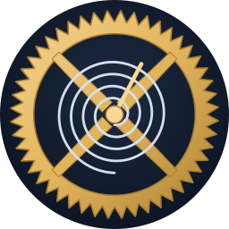
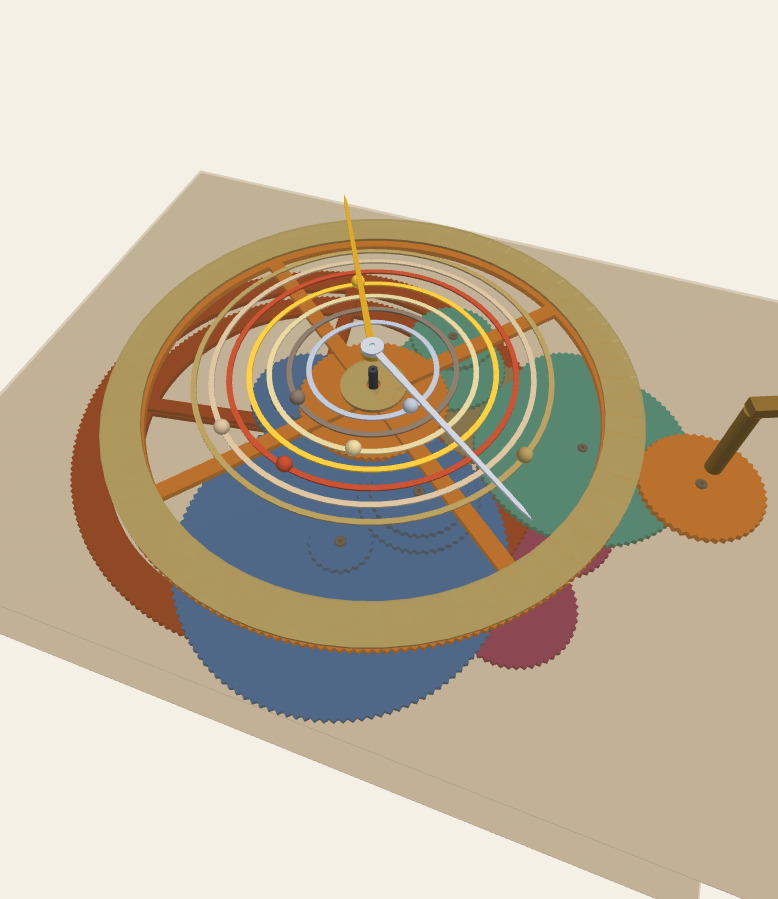
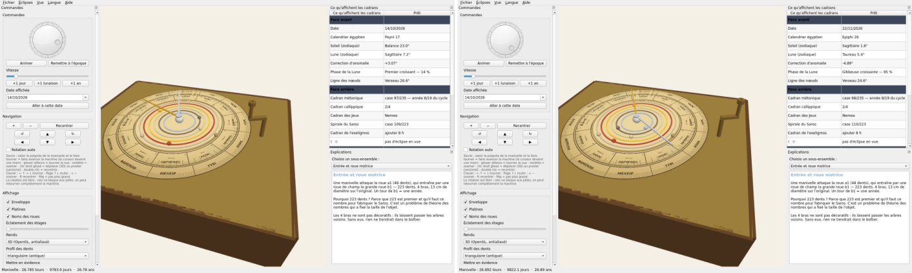
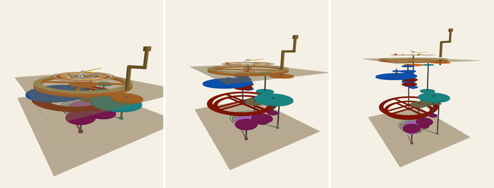
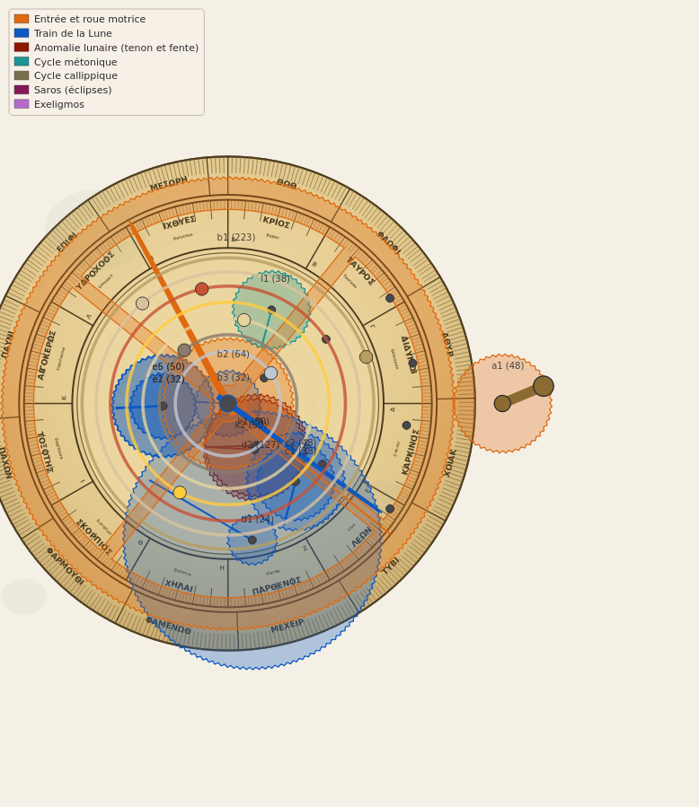

<p align="center">
  
</p>

# Anticythere3D — simulateur de la machine d'Anticythère

*[English version below](#anticythere3d--antikythera-mechanism-simulator)*

Un simulateur 3D **fonctionnel** de la machine d'Anticythère : on saisit la
manivelle à la souris et on la tourne, les 33 roues tournent, et tous les
cadrans affichent ce que lisait son propriétaire il y a 2 100 ans. L'enveloppe
se retire pour voir le mécanisme, l'éclatement écarte les étages le long des
arbres, et chaque sous-ensemble est expliqué dans l'application.

Interface **entièrement bilingue français / anglais**, commutable à chaud, qui
démarre dans la langue du système. **Windows, macOS et Linux**, avec mise à
jour automatique et rapports d'incident sur les trois.

Deux rendus au choix : **3D** temps réel (fond clair, antialiasing 8×) et
**vectoriel 2D**, en courbes, exportable en SVG / PDF — sans aucun pixel.






---

## Installation

### Le plus simple : le paquet prêt à l'emploi

Tous les paquets sont sur la page des
[versions](https://github.com/ARP273-ROSE/Anticythere3D/releases/latest). Ils
embarquent leur propre Python : rien d'autre à installer, aucun mot de passe
administrateur.

| Système | Fichier | Installation |
|---|---|---|
| **Windows** | [`Anticythere3D-Setup.exe`](https://github.com/ARP273-ROSE/Anticythere3D/releases/latest/download/Anticythere3D-Setup.exe) (lien permanent) | Lancer l'installeur. « Windows a protégé votre ordinateur » (installeur non signé) : *Informations complémentaires* puis *Exécuter quand même*, une seule fois. |
| **macOS** Apple Silicon / Intel | `Anticythere3D-<version>-macos-arm64.dmg` / `-macos-x86_64.dmg` | Ouvrir l'image, glisser l'application dans *Applications*. Non signée : la première fois, **clic droit → Ouvrir**, puis confirmer. |
| **Linux** x86_64 / ARM64 | `Anticythere3D-<version>-linux-x86_64.tar.gz` / `-linux-arm64.tar.gz` | Décompresser, lancer `./installer.sh` : installation dans `~/.local/share`, entrée de menu, **sans sudo**. |

Ensuite, le programme se met à jour **tout seul**, sur les trois systèmes : il
détecte la nouvelle version au démarrage et propose de l'installer (ou **Aide →
Rechercher une mise à jour**) ; seule une petite archive de code est
téléchargée. S'il plante ou se fige, il peut le signaler de lui-même à son
auteur, avec ton accord (demandé au premier lancement, modifiable dans le menu
Aide) ; **Aide → Signaler un problème…** envoie un signalement écrit. Rien
d'autre ne quitte la machine : ni noms de fichiers, ni nom d'utilisateur. Les
réglages et rapports vivent hors du dossier d'installation (`%LOCALAPPDATA%`,
`~/Library/Application Support`, `~/.local/share`) : une mise à jour ne les
touche pas.

### Sous Windows, depuis les sources

Double-clique sur **`launch.bat`** : il crée l'environnement, installe les
dépendances et démarre le simulateur. S'il y a une erreur, il l'affiche au lieu
de se fermer.

### En ligne de commande

Il suffit d'avoir **Python 3.10 ou plus récent** :

```bash
python run.py
```

Au premier lancement, le programme détecte ce qui manque et l'installe
lui-même, **3D comprise** (`PyQt6`, `numpy`, `pyqtgraph`, `PyOpenGL`), puis
redémarre pour les charger. Hors environnement virtuel il installe avec
`--user` : rien n'est écrit dans les paquets système.

```bash
python run.py --check        # liste ce qui manque, n'installe rien
python run.py --no-install   # démarre sans rien installer
python run.py --lang en      # interface en anglais (défaut : langue du système)
python run.py --vector       # démarre en rendu vectoriel
python run.py --samples 16   # antialiasing plus poussé (défaut : 8)
```

Si tu préfères un environnement isolé, la voie classique marche aussi :

```bash
python -m venv .venv
source .venv/bin/activate        # Windows : .venv\Scripts\activate
pip install -r requirements.txt
python run.py
```

**Sous Linux**, Qt réclame en plus quelques bibliothèques système. Leur absence
ne lève pas d'exception, elle tue le processus — le programme le détecte donc
dans un sous-processus isolé et affiche la commande exacte à lancer
(`apt`, `dnf` ou `pacman` selon la distribution). Sous Windows et macOS,
rien à faire : les binaires PyQt6 embarquent tout.

**Si OpenGL n'est pas disponible**, l'application bascule automatiquement sur le
rendu vectoriel, qui montre les mêmes rotations — elle ne plante pas.

📖 **Manuel complet illustré** : [`docs/Manuel.pdf`](docs/Manuel.pdf) (9 pages, FR + EN).

## Ce que fait le programme

| Fonction | Détail |
|---|---|
| **Manivelle** | La seule entrée de la machine, comme sur l'original. **On saisit sa poignée à la souris**, dans la vue 3D comme dans le rendu vectoriel, et on la fait tourner : un tour de poignée = 48/223 d'année (78,6 jours), tout le mécanisme suit. Le curseur devient une main au survol ; ailleurs, glisser fait toujours tourner la vue. Aussi : bouton rotatif (un tour = une année), pas à pas (+1 jour / +1 lunaison / +1 an), animation continue, ou saisie directe d'une date. |
| **Vue 3D** | Fond clair, antialiasing 8×. Rotation, zoom, vues avant / arrière / trois-quarts. Les 33 roues tournent **à leur vitesse réelle**, y compris le tenon-fente et son porte-satellite qui orbite. |
| **Retirer l'enveloppe** | Une case à cocher enlève le boîtier, une autre les platines. Le curseur *Éclatement des étages* écarte les 16 plans d'engrènement **le long des arbres** : aucune roue ne bouge dans son plan, celles qui s'engrènent restent face à face, les arbres s'allongent, et aucune pièce n'en pénètre une autre (vérifié par les tests à six valeurs du curseur). |
| **Couleurs** | Une couleur par sous-ensemble (entrée, Lune, tenon-fente, métonique, callippique, Saros, exeligmos), avec sa légende. Palette calculée : écart CIEDE2000 > 20 entre tous les trains, et encore > 15 entre trains voisins en deutéranopie et protanopie simulées. |
| **Mise en évidence** | Éteint tout sauf un sous-ensemble : entrée, Lune, anomalie, métonique, callippique, Saros, exeligmos. |
| **Profil des dents** | Bascule entre les **triangles** de la machine antique et la **développante de cercle** moderne — la différence se voit à l'écran. |
| **Report des cadrans** | Panneau détachable : date, calendrier égyptien, Soleil et Lune dans le zodiaque, correction d'anomalie, phase, ligne des nœuds, case métonique, cadran callippique, Jeux, case du Saros, correction de l'exeligmos, prédiction d'éclipse, planètes, **et l'écart entre la machine et le ciel réel**. |
| **Explications** | Un texte par sous-ensemble, avec les nombres de dents, les rapports exacts et pourquoi ils sont ce qu'ils sont. |
| **Aide** | Manuel intégré (F1), table des rapports exacts, raccourcis clavier, à propos. Tooltips bilingues partout. |
| **Rendu vectoriel** | Second mode de rendu, en courbes : dentures réelles, molette pour zoomer, glisser pour déplacer, face avant / arrière. **Aucun pixel, à n'importe quel zoom.** |
| **Export** | Capture PNG, **SVG et PDF A3 vectoriels** (aucune image bitmap à l'intérieur), export CSV des valeurs affichées. |

## Ce qui est simulé, et avec quelle exactitude

Les rapports ne sont pas approchés : ils sont calculés en **arithmétique
rationnelle exacte** (`fractions.Fraction`) à partir des nombres de dents
relevés par tomographie X.

| Sortie | Rapport exact | Contrôle |
|---|---|---|
| Lune sidérale | `254/19` | mois sidéral 27,321 266 j |
| Porte-satellite e3 | `477/4237` | 8,8826 ans (apogée lunaire : 8,8504) |
| Anomalie (tenon-fente) | — | période **27,5533 j** contre 27,554 550 : **1,8 minute d'écart** |
| Métonique | `5/19` | 5 tours en 19 ans |
| Callippique | `1/76` | 1 tour en 76 ans |
| Saros | `940/4237` | 4 tours pour 223 lunaisons |
| Exeligmos | `235/12711` | 1 tour en 54,09 ans = 3 Saros |

L'application affiche en permanence **son propre écart au ciel réel**, calculé
par éphémérides modernes (Meeus, validé contre `skyfield` : moins de 0,04° sur
la Lune, 0,015° sur le Soleil entre 1900 et 2050).

Sur la Lune, la machine dérive de quelques degrés par siècle. Ce n'est pas un
bug, et le programme le décompose : les termes d'évection et de variation ne
sont pas mécanisés (2,2°), l'approximation `254/19` dérive (3,5° par 50 ans),
et la précession de l'apogée est légèrement fausse (0,8°).

## Ce qui est gravé sur chaque cadran

Les cadrans ne sont pas décoratifs : chaque trait porte une information. Le
programme grave les mêmes inscriptions que la machine, aux mêmes places.

**Face avant** — le zodiaque (12 × 30°, les noms grecs depuis le point vernal,
avec *Chêlai*, « les pinces », là où nous disons Balance), les lettres-index du
**parapegma** qui renvoient à un calendrier d'étoiles, l'anneau calendaire
égyptien mobile (365 ou 354 divisions, le débat n'est pas tranché), les sept
anneaux du **Cosmos** et la bille de phase.

**Face arrière** :

| Cadran | Divisions | Ce qui est écrit |
|---|---|---|
| **Métonique** | spirale, 5 tours, **235 cases** | une case = un mois lunaire ; chacune porte le nom de son mois corinthien (*Phoinikaios*, *Kraneios*…). Le numéro d'année en chiffres grecs marque chacune des 19 années — dont les **7 années à 13 mois**, données par (12k) mod 19 < 7. |
| **Callippique** | 4 secteurs | lequel des quatre cycles métoniques (76 ans) on parcourt, donc le jour à retrancher |
| **Jeux** | 4 secteurs | *Olympia*, *Nemea*, *Isthmia*, *Pythia* — le seul cadran non astronomique |
| **Saros** | spirale, 4 tours, **223 cases** | les cases où une éclipse est possible portent **Η** (*Hêlios*, Soleil) ou **Σ** (*Selênê*, Lune) |
| **Exeligmos** | 3 secteurs | 0, 8 ou 16 heures à **ajouter** à l'heure lue sur le Saros |

Pourquoi 223 ? Parce que trois périodes lunaires y coïncident à moins de cinq
heures près sur dix-huit ans : 223 mois synodiques (même phase), 242
draconitiques (même nœud), 239 anomalistiques (même distance). L'éclipse se
répète. Le reste de 0,321 jour la décale de 7,7 h — soit 116° de longitude —
et c'est l'exeligmos qui en rend compte.

> ⚠️ **Les glyphes d'éclipse sont calculés, pas copiés.** Le motif de la plaque
> originale n'est connu que par fragments. Le programme applique le critère que
> la machine mécanise — syzygie proche d'un nœud — sur les 223 mois d'un Saros :
> 48 cases solaires, 32 lunaires, 22 portant les deux. C'est un peu plus que les
> glyphes gravés, les limites retenues incluant des éclipses rasantes.

## Implantation des arbres

Les positions des 15 arbres ne sont pas dessinées à la main. Elles résultent
d'une **optimisation sous contraintes** (SageMath + scipy) imposant simultanément
les 17 entraxes exacts, la fermeture des deux boucles cinématiques, et
l'absence de collision — en tenant compte du fait que b1, e3 et e4 sont des
roues **à bras**, donc évidées. Résultat : entraxes exacts au micron, aucune
collision, encombrement 277 × 257 mm au module 1,0.

## Structure

```
anticythere/
  kinematics.py   trains, rapports exacts, tenon-fente, sorties des cadrans
  astro.py        éphémérides de référence (Meeus) et calage de la machine
  layout.py       implantation des arbres, étages, éclatement, couleurs
  palette.py      CIEDE2000, contraste, simulation des daltonismes
  geometry.py     maillages 3D (roues, bras, spirales, pointeurs, boîtier)
  view3d.py       vue OpenGL (fond clair, MSAA 8x)
  view2d.py       rendu vectoriel QPainter + export SVG / PDF
  mainwindow.py   fenêtre, commandes, report des cadrans, explications, aide
  i18n.py         toutes les chaînes, FR et EN
tests/
  test_mechanism.py      16 séries de tests, exécutables sans écran
  test_gui.py            11 séries de tests d'interface (Xvfb)
  test_confidentialite.py  garde-fou : aucune donnée personnelle
run.py
build_package.py, installer.iss   paquet et installeur Windows
build_unix.py                     paquets macOS (.app) et Linux (dossier + installer.sh)
```

## Tests

```bash
python tests/test_mechanism.py
xvfb-run -a python tests/test_gui.py      # sous Linux : il faut un vrai serveur X
```

Vérifie les rapports contre les valeurs calculées indépendamment sous SageMath,
le mois anomalistique, le tenon-fente, le retour à l'origine de chaque cadran
après un cycle complet, les périodes planétaires, l'astronomie de référence,
le budget d'erreur, la validité des 33 maillages, les 17 entraxes, l'éclatement
(aucune collision, aucun déplacement dans le plan), la palette (CIEDE2000,
daltonismes simulés) et l'absence de texte non traduit — clés manquantes **et**
textes affichés écrits en dur. Les tests d'interface tournent la manivelle à la
souris, vérifient la molette, l'éclatement réellement affiché, et qu'aucun
texte français ne reste dans l'interface anglaise (et inversement).

## Sources

Toutes les données proviennent des publications primaires :

- Freeth T. *et al.*, « Decoding the ancient Greek astronomical calculator known
  as the Antikythera Mechanism », **Nature 444** (2006) 587–591 + notes
  supplémentaires (nombres de dents).
- Freeth T., Jones A., Steele J., Bitsakis Y., « Calendars with Olympiad display
  and eclipse prediction… », **Nature 454** (2008) 614–617.
- Freeth T., Higgon D., Dacanalis A., MacDonald L., Georgakopoulou M., Wojcik A.,
  « A Model of the Cosmos in the ancient Greek Antikythera Mechanism »,
  **Scientific Reports 11:5821** (2021).
- Meeus J., *Astronomical Algorithms*, 2ᵉ éd., ch. 7, 25, 47.

Ce qui relève d'une **reconstitution** et non d'un relevé — le détail des
mécanismes planétaires, l'aiguille des nœuds — est signalé comme tel dans
l'application.

---

# Anticythere3D — Antikythera Mechanism simulator

A **working** 3D simulator of the Antikythera Mechanism: grab the crank with the
mouse and turn it, all 33 gears turn, and every dial shows what its owner read
2,100 years ago. The case can be removed to reveal the movement, the levels can
be exploded along the arbors, and each subsystem is explained inside the
application. Fully **bilingual French / English**, switchable at runtime,
starting in the system's language. **Windows, macOS and Linux**, with automatic
updates and crash reports on all three.

## Install

**Ready-made packages** are on the
[releases page](https://github.com/ARP273-ROSE/Anticythere3D/releases/latest).
They bundle their own Python; no administrator password is needed.

| System | File | How to install |
|---|---|---|
| **Windows** | [`Anticythere3D-Setup.exe`](https://github.com/ARP273-ROSE/Anticythere3D/releases/latest/download/Anticythere3D-Setup.exe) (permanent link) | Run the installer. "Windows protected your PC" (unsigned installer): *More info*, then *Run anyway*, once. |
| **macOS** Apple Silicon / Intel | `Anticythere3D-<version>-macos-arm64.dmg` / `-macos-x86_64.dmg` | Open the image, drag the app into *Applications*. Unsigned: the first time, **right-click → Open**, then confirm. |
| **Linux** x86_64 / ARM64 | `Anticythere3D-<version>-linux-x86_64.tar.gz` / `-linux-arm64.tar.gz` | Unpack, run `./installer.sh`: installs into `~/.local/share` with a menu entry, **no sudo**. |

The program then updates itself on all three systems (it detects a new
version at start-up, or **Help → Check for updates**), and can report crashes
and freezes to its author with your consent (asked once, changeable in the
Help menu); **Help → Report a problem…** sends a written report. Nothing else
leaves the machine: no file names, no user name. Settings and reports live
outside the installation folder, so updates never touch them.

**From source**:

```bash
python -m venv .venv
source .venv/bin/activate        # Windows: .venv\Scripts\activate
pip install -r requirements.txt
python run.py --lang en
```

Python 3.10+. If OpenGL is unavailable the app falls back to an animated 2D
diagram rather than failing.

## What it does

Crank input — **grab the handle with the mouse and turn it** (one turn of the
handle = 48/223 of a year, 78.6 days), or use the knob (one turn = one year) —,
3D view with removable case, levels exploded **along the arbors** (no gear ever
moves within its plane or intersects another), a colour per subsystem chosen
to stay distinct with colour-vision deficiency (CIEDE2000 > 20, legend in the
interface), subsystem highlighting, switch between the **ancient triangular tooth
profile** and the modern **involute**, a detachable panel reporting every dial
reading, per-subsystem explanations, built-in manual (F1), bilingual tooltips
throughout, plus a second **vector rendering mode** (real tooth outlines, wheel
to zoom, drag to pan) exporting to **SVG and A3 PDF with no bitmap inside**, and
PNG / CSV export.

## What the dials say

The dials are not decoration — every mark carries a reading, and the program
engraves the same inscriptions the machine had, in the same places.

**Front**: the zodiac (12 × 30°, Greek names from the vernal point, including
*Chêlai*, "the claws", where we say Libra), the **parapegma** index letters
keying into a star calendar, the movable Egyptian calendar ring (365 or 354
divisions — still debated), the seven **Cosmos** rings and the phase ball.

**Back**:

| Dial | Divisions | What is written |
|---|---|---|
| **Metonic** | spiral, 5 turns, **235 cells** | one cell = one lunar month, each named after its Corinthian month (*Phoinikaios*, *Kraneios*…). Greek numerals mark each of the 19 years — including the **7 years of 13 months**, given by (12k) mod 19 < 7. |
| **Callippic** | 4 sectors | which of the four Metonic cycles (76 years) you are in, hence the day to drop |
| **Games** | 4 sectors | *Olympia*, *Nemea*, *Isthmia*, *Pythia* — the only non-astronomical dial |
| **Saros** | spiral, 4 turns, **223 cells** | cells where an eclipse is possible carry **Η** (*Hêlios*, Sun) or **Σ** (*Selênê*, Moon) |
| **Exeligmos** | 3 sectors | 0, 8 or 16 hours to **add** to the time read on the Saros |

Why 223? Because three lunar periods coincide there to within five hours over
eighteen years: 223 synodic months (same phase), 242 draconic (same node), 239
anomalistic (same distance). The eclipse repeats. The leftover 0.321 day shifts
it by 7.7 h — some 116° of longitude — which is what the exeligmos accounts for.

> ⚠️ **The eclipse glyphs are computed, not copied.** The original plate's
> pattern survives only in fragments. The program applies the very criterion the
> machine mechanises — syzygy near a node — over the 223 months of one Saros:
> 48 solar cells, 32 lunar, 22 carrying both. Slightly more than the engraved
> glyphs, since the adopted limits include grazing eclipses.

## Accuracy

Gear ratios are held as **exact rationals**, from the tomography-derived tooth
counts. The pin-and-slot device, mounted on a carrier turning once per 8.8826
years, produces a modulation of period **27.5533 days** — the anomalistic month
to within **1.8 minutes**. The app continuously displays its own error against
modern ephemerides, and the test suite bounds that error by an explicit physical
budget (unmodelled evection and variation, `254/19` drift, apogee precession).

## Tests

```bash
python tests/test_mechanism.py
```

Sixteen headless test groups: exact ratios cross-checked against SageMath,
anomalistic month, pin-and-slot extremes, every dial returning to its origin
after a full cycle, planetary period relations, reference astronomy, error
budget, 33 valid meshes, 17 exact centre distances, collision-free explosion,
colour palette (CIEDE2000, simulated colour blindness), and no untranslated
string — neither missing keys nor hard-coded displayed text. Plus eleven GUI
test groups (`xvfb-run -a python tests/test_gui.py`): crank turned with the
mouse in both renderings, mouse wheel, explosion as actually displayed, and no
French left in the English interface (and vice versa).

---

## Licence et attribution

Code écrit pour ce projet, sans emprunt. Les données scientifiques (nombres de
dents, relations de période) proviennent des publications citées plus haut et
appartiennent à leurs auteurs. Les captures d'écran de `docs/` sont produites
par le programme lui-même.
